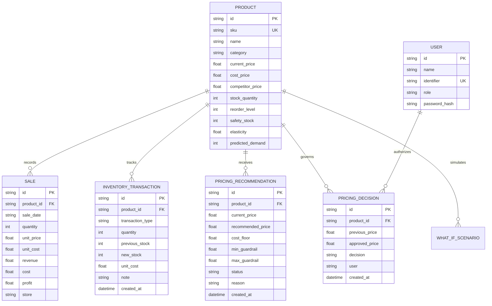

# System Overview & Architecture Specification
## SmartPrice Explainable AI Retail Optimization Suite

---

## 1. Executive Summary & Problem Statement

### 1.1 The Retail Pricing Dilemma
Modern retail enterprises face complex pricing dilemmas characterized by:
- **Erosion of Profit Margins**: Retailers frequently engage in reactive price-cutting wars with competitors without accounting for wholesale acquisition costs, leading to margin collapse.
- **Supply-Demand Mismatches**: Unsynchronized inventory depth and price positioning cause either severe stockouts on price-elastic goods or sluggish overstock accumulation on high-margin goods.
- **The Black-Box Explanability Barrier**: Sophisticated machine learning algorithms often fail adoption hurdles in retail operations because store managers and category directors cannot verify *why* a specific price was recommended or whether statutory and corporate gross-margin floors were respected.
- **Executive Override Governance**: Ad-hoc discounts, promotional liquidations, or below-cost overrides are frequently applied without audit logging, or worse, stale override prices leak back into automated systems as permanent catalog recommendations.

### 1.2 System Objectives
The **SmartPrice Explainable AI Retail Optimization Suite** addresses these challenges by providing:
1. **Gross-Margin Guardrails**: Enforcing mathematical minimum-margin price floors ($\text{floor} = \frac{\text{cost}}{1 - (\text{min\_margin\_pct} / 100)}$) that strictly prevent automated below-cost pricing unless explicitly approved via audited executive override workflows.
2. **Transparent Demand & Elasticity Modeling**: Providing multi-horizon demand forecasting (7-day, 30-day, and 90-day) with proven mathematical additivity and stockout risk evaluation.
3. **Deterministic Explainable Attribution**: Disclosing explicit factor-by-factor waterfall price decompositions that attribute recommendations directly to observable economic drivers (competitor price gaps, inventory days-on-hand, and category margin targets).
4. **Data Integrity & Reconciliation**: Guaranteeing that ledger transactions, sales records, catalog stock balances, and financial report metrics reconcile mathematically to their underlying database sources of truth.

---

## 2. System Scope & Functional Capabilities

```mermaid
flowchart TD
    subgraph Client["Presentation Layer (React 18 + Vite)"]
        UI_Dash["Executive Dashboard"]
        UI_Cat["Product Catalog & Details"]
        UI_Opt["Price Optimization & Approvals"]
        UI_Sim["What-If Scenario Simulation"]
        UI_FC["Multi-Horizon Demand Forecasting"]
        UI_XAI["Explainable AI & Waterfall Attribution"]
        UI_Inv["Inventory Intelligence & Reconciliation"]
        UI_Rep["Audited Business & Financial Reports"]
    end

    subgraph Service["Application Core (FastAPI Backend)"]
        AuthSvc["AuthService & Rate Limiter"]
        ProdSvc["ProductService"]
        PriceSvc["PricingService & Guardrail Engine"]
        WhatIfSvc["WhatIfService"]
        FCSvc["ForecastService (7d/30d/90d)"]
        ShapSvc["ShapService & Attribution Facade"]
        InvSvc["InventoryService & Ledger Engine"]
        RepSvc["ReportService & Reconciler"]
    end

    subgraph Storage["Persistence Layer (SQLite Database)"]
        DB_Products[("products (11)")]
        DB_Sales[("sales (160)")]
        DB_InvTx[("inventory_transactions (54)")]
        DB_Decisions[("pricing_decisions (226)")]
        DB_Recs[("pricing_recommendations (10)")]
        DB_Users[("users (10)")]
        DB_Scenarios[("what_if_scenarios (5)")]
    end

    Client <-->|RESTful JSON / Bearer JWT| Service
    Service <-->|SQLAlchemy ORM (WAL mode)| Storage
```

---

## 3. Technology Stack & Architectural Decisions

### 3.1 Backend Stack
- **Framework**: FastAPI (v0.110+) on Python 3.12.
- **ASGI Server**: Uvicorn.
- **ORM / Persistence**: SQLAlchemy 2.0+ with SQLite 3 (WAL mode enabled).
- **Authentication**: JWT (JSON Web Tokens) with HS256 signatures, PBKDF2/SHA256 password hashing, and in-memory IP rate-limiting.
- **Data Validation & Schemas**: Pydantic v2.

### 3.2 Frontend Stack
- **Framework**: React 18 with modern functional components and hooks.
- **Build Tool**: Vite 6 (ESBuild bundling).
- **Styling**: Tailwind CSS with custom responsive layout tokens.
- **State Management**: Centralized React Contexts (`AuthContext`, `StoreContext`, `ThemeContext`).
- **Data Visualization**: Recharts (ComposedChart, Line, Area, Bar, ResponsiveContainer) and custom SVG components.
- **Icons**: Lucide React.

### 3.3 Rationale for Architectural Choices
1. **FastAPI & Pydantic**: Provides strict, automated runtime validation of request/response contracts, preventing data corruption and contract drift between frontend and backend.
2. **SQLite with WAL Mode**: Embedded zero-configuration persistence suited for self-contained optimization suites, maintaining full ACID guarantees with concurrent readers and serialized writers.
3. **Decoupled Analytics Engine**: Calculation logic is modularized into dedicated backend services (`PricingService`, `InventoryService`, `ForecastService`, `ReportService`) complemented by synchronous client-side utilities (`analytics.js`, `productUtils.js`), ensuring deterministic computations whether operating online or in cached client state.

---

## 4. Entity-Relationship Data Model

The data layer models retail operations across products, sales, inventory mutations, pricing recommendations, and executive decisions:



---

## 5. End-to-End Data Flow

1. **Catalog & Inventory Ingestion**:
   - Products are stored in the database with their current shelf price, unit acquisition cost, competitor benchmark, and physical on-hand inventory.
   - The authoritative stock level is defined exclusively as `Product.stock_quantity`.
2. **Optimization & Guardrail Evaluation**:
   - `PricingService` executes a discrete price grid search across allowable bounds ($\pm 20\%$ to $\pm 30\%$).
   - Projected demand at each candidate price is derived using the product's price elasticity coefficient:
     $$\Delta Q = Q_0 \times \left( \epsilon \times \frac{P - P_0}{P_0} \right)$$
   - The candidate price maximizing expected gross profit ($\text{Demand} \times (P - \text{Cost})$) is selected as the unconstrained AI optimal target.
   - The AI optimal target is passed through corporate margin guardrails. If the price falls below the statutory floor ($\frac{\text{cost}}{1 - \text{margin}}$), it is clamped to the floor and flagged with a dynamic clamping explanation.
3. **Forecasting & Run-Rate Harmonization**:
   - `ForecastService` scales baseline monthly sales to target horizons ($7/30$ for 7 days, $1.0\times$ for 30 days, $3.0\times$ for 90 days).
   - Daily run rates and days of supply are calculated to determine stockout risk.
4. **Attribution & Transparency**:
   - `ShapService` decomposes the delta between baseline price and recommended price into additive waterfall components.
   - Natural-language rationales and driver flags are delivered to the frontend for operational auditability.

