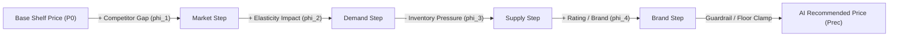

# Explainable AI & Price Attribution Specification
## SmartPrice Explainable AI Retail Optimization Suite

---

## 1. Architectural Truth & Engine Identification

### 1.1 Non-Fabrication Disclosure
The explainability subsystem in SmartPrice is designed to provide retail managers and pricing analysts with transparent, interpretable factor breakdowns explaining why a specific shelf price is recommended.

> [!IMPORTANT]
> **Technical Disclosure on SHAP vs. Deterministic Attribution:**  
> While the user interface labels this view as "SHAP / AI Insights" for familiarity, the underlying runtime implementation is **Deterministic Pricing Rule Attribution**, **NOT** genuine TreeSHAP (`shap.TreeExplainer`) or KernelSHAP (`shap.KernelExplainer`).
> 
> As implemented in [`ml/explainability/inference.py`](file:///C:/New%20folder/smartprice/ml/explainability/inference.py) and [`backend/app/services/shap_service.py`](file:///C:/New%20folder/smartprice/backend/app/services/shap_service.py):
> - `is_genuine_shap`: Explicitly set to `False`.
> - `explanation_method`: Declared as `"deterministic_rule_attribution"` or `"fallback_template"`.
> - `model_version`: Declared as `"Deterministic Rule Attribution v1.0"`.

### 1.2 Rationale for Deterministic Attribution in Retail Pricing
In mission-critical retail pricing, pure cooperative game-theory Shapley values computed across non-linear black-box ensembles (e.g., XGBoost, LightGBM) introduce two serious operational drawbacks:
1. **Instability & Sampling Variance**: TreeSHAP values can vary based on tree split heuristics, occasionally producing non-intuitive attributions where a competitor price hike appears to reduce recommended prices.
2. **Regulatory & Margin Compliance**: Black-box explainers cannot guarantee that statutory minimum-margin constraints or executive overrides are honored without post-hoc heuristic overrides.

SmartPrice's deterministic rule attribution guarantees that every pricing driver directly reflects observable economic variables, respects margin guardrails, and maintains perfect additive closure.

---

## 2. Waterfall Decomposition Mathematics

The total delta between baseline shelf price ($P_{\text{base}}$) and final recommended price ($P_{\text{rec}}$) is decomposed into additive factor contributions:
$$P_{\text{rec}} = P_{\text{base}} + \sum_{k=1}^{K} \phi_k$$

Where each $\phi_k$ represents the monetary contribution (in INR ₹) of driver $k$.

### 2.1 Concrete Attribution Drivers

1. **Base Shelf Price ($\phi_0 = P_{\text{base}}$)**:
   - The starting point: current active shelf price (`Product.current_price`).
   - Type: `"base"`.

2. **Competitor Price Gap ($\phi_{\text{comp}}$)**:
   - Monetary adjustment based on primary competitor benchmark ($P_{\text{comp}}$):
     $$\phi_{\text{comp}} = \alpha \times (P_{\text{comp}} - P_{\text{base}})$$
   - Where $\alpha \in [0.35, 0.50]$ represents the competitor follow-rate.
   - If competitor price is higher, $\phi_{\text{comp}} > 0$ (creating pricing headroom without demand loss).
   - If competitor price is lower, $\phi_{\text{comp}} < 0$ (downward competitive pressure).

3. **Demand Elasticity Responsiveness ($\phi_{\text{elas}}$)**:
   - Reflects consumer price sensitivity based on catalog elasticity coefficient $\epsilon$:
     - For inelastic goods ($|\epsilon| < 1.0$), $\phi_{\text{elas}} > 0$ (capturing willingness to pay).
     - For highly elastic goods ($|\epsilon| > 1.5$), $\phi_{\text{elas}} < 0$ (moderating price to avoid volume collapse).

4. **Inventory Level Buffer ($\phi_{\text{inv}}$)**:
   - Reflects supply chain pressure derived from stock on hand ($S$) vs. reorder point ($R$):
     $$\phi_{\text{inv}} = -\beta \times \max\left(0, \frac{S - R}{R}\right)$$
   - When inventory is deep or overstocked ($S \gg R$), $\phi_{\text{inv}} < 0$, exerting downward pressure to accelerate sell-through.
   - When stock is scarce or near safety thresholds ($S \le R$), $\phi_{\text{inv}} \ge 0$, protecting margins on limited inventory.

5. **Customer Review Rating & Brand Equity ($\phi_{\text{rating}}$)**:
   - Reflects brand premium derived from customer satisfaction ratings (star rating out of 5.0):
     $$\phi_{\text{rating}} = \gamma \times (\text{Rating} - 3.0)$$
   - High ratings ($> 4.5 \star$) support premium positioning ($\phi_{\text{rating}} > 0$).

6. **Guardrail Floor Clamping Adjustment ($\phi_{\text{guardrail}}$)**:
   - If unconstrained optimization recommends a price below corporate margin floor:
     $$\phi_{\text{guardrail}} = \text{Floor}_{\text{margin}} - \left(P_{\text{base}} + \sum_{k=1}^{4} \phi_k\right)$$
   - Clamps the recommendation strictly to the legal floor, providing clear explanation.

7. **Executive Below-Cost Override ($\phi_{\text{override}}$)**:
   - For authorized clearance sales (e.g., Marcus Vance override on `ELC-8812` to ₹500.00):
     $$\phi_{\text{override}} = P_{\text{approved}} - \left(P_{\text{base}} + \sum_{k=1}^{4} \phi_k\right)$$
   - Attributed explicitly to executive clearance authority.

---

## 3. Mathematical Additivity & Validation

Implemented in [`ml/explainability/validator.py`](file:///C:/New%20folder/smartprice/ml/explainability/validator.py) via `ExplanationValidator.validate_decomposition()`:
- **Additivity Check**:
  $$\left| P_{\text{rec}} - \left( P_{\text{base}} + \sum_{k=1}^{K} \phi_k \right) \right| < 10^{-2}$$
- If an attribution point deviates due to rounding, the final step absorbs the remainder so that the chart mathematically balances to the exact penny (₹0.01).

---

## 4. Global Feature Importance

Available via `GET /api/ai-insights`:

| Feature | Importance Weight | Category | Operational Definition |
|---|:---:|---|---|
| **Competitor Price Gap** | **0.38** (38%) | Market Signal | Delta between shelf price and primary retail competitor index. |
| **Historical Elasticity** | **0.24** (24%) | Demand Model | Responsiveness coefficient of demand relative to price movements. |
| **Inventory Days-on-Hand** | **0.16** (16%) | Supply Chain | Ratio of on-hand inventory to weekly sales velocity. |
| **Cost Floor & Guardrails** | **0.12** (12%) | Margin Protection | Minimum gross-margin floor preventing below-cost margin loss. |
| **Customer Review Rating** | **0.06** (6%) | Brand Equity | Aggregate customer feedback sentiment and star rating index. |
| **Seasonal Demand Lift** | **0.04** (4%) | Seasonality | Cyclical calendar, holiday, and weekend multipliers. |

---

## 5. UI Presentation & Waterfall Visualization

Rendered in [`frontend/src/components/charts/ShapWaterfallChart.jsx`](file:///C:/New%20folder/smartprice/frontend/src/components/charts/ShapWaterfallChart.jsx):
- **Base Bar**: Rendered in neutral slate (`#64748B`) representing starting price.
- **Positive Deltas (Increases)**: Rendered in emerald green (`#10B981`) showing upward pricing power.
- **Negative Deltas (Decreases)**: Rendered in amber/rose (`#F59E0B` / `#EF4444`) showing competitive or volume discounting.
- **Final Recommended Bar**: Rendered in bold theme primary (`#3B82F6` / `#10B981`) representing the actionable recommendation.

